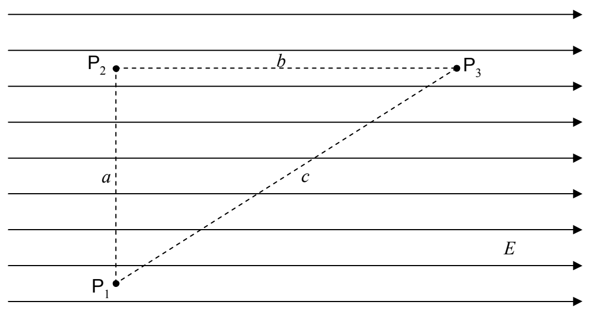

# 5 Work Done by the Electric Field, and, the Electric Potential

When a charged particle moves from one position in an electric field to another position in that same electric field, the electric field does work on the particle. The work done is conservative; hence, we can define a potential energy for the case of the force exerted by an electric field. This allows us to use the concepts of work, energy, and the conservation of energy, in the analysis of physical processes involving charged particles and electric fields.

We have defined the work done on a particle by a force, to be the force-along-the-path times the length of the path, with the stipulation that when the component of the force along the path is different on different segments of the path, one has to divide up the path into segments on each of which the force-along-the-path has one value for the whole segment, calculate the work done on each segment, and add up the results.

Let’s investigate the work done by the electric field on a charged particle as it moves in the electric field in the rather simple case of a uniform electric field. For instance, let’s calculate the work done on a positively-charged particle of charge $q$ as it moves from point $\mathsf{P}_{1}$ to point $\mathsf{P}_{3}$

along the path: “From $\mathsf{P}_{1}$ straight to point $\mathsf{P}_{2}$ and from there, straight to $\mathsf{P}_{3}$.” Note that we are not told what it is that makes the particle move. We don’t care about that in this problem. Perhaps the charged particle is on the end of a quartz rod (quartz is a good insulator) and a person who is holding the rod by the other end moves the rod so the charged particle moves as specified.
