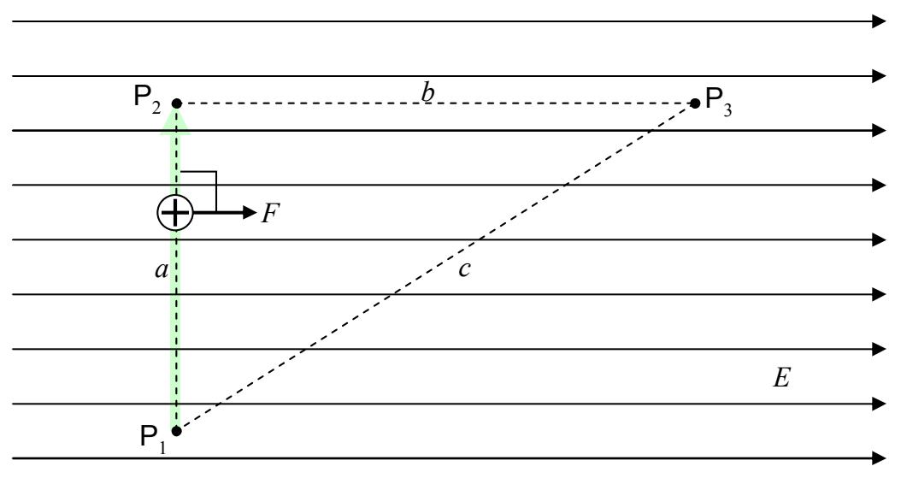

Along the first part of the path, from $P_{1}$ to $P_{2}$, the force on the charged particle is perpendicular to the path.

The force has no component along the path so it does no work on the charged particle at all as the charged particle moves from point $P_{1}$ to point $P_{2}$.

$$
\mathcal {W} _ {1 2} = 0
$$

From $P_{2}$, the particle goes straight to $P_{3}$.
