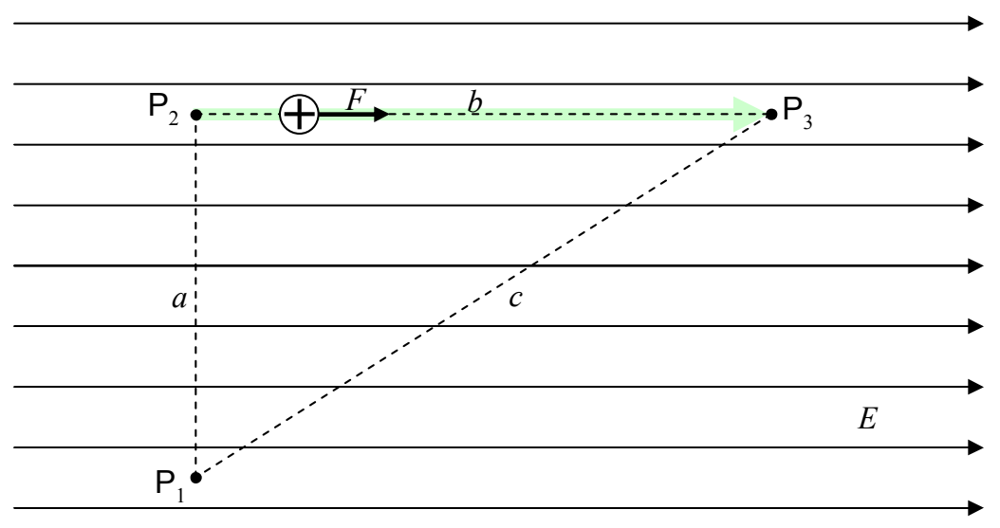

On that segment of the path (from \( \mathsf{P}_{2} \) to \( \mathsf{P}_{3} \)) the force is in exactly the same direction as the direction in which the particle is going.

As such, the work is just the magnitude of the force times the length of the path segment:

\[
\mathcal {W} _ {2 3} = F b
\]

The magnitude of the force is the charge of the particle times the magnitude of the electric field F=qE, so,

\[
\mathcal {W} _ {2 3} = q E b
\]

Thus, the work done on the charged particle by the electric field, as the particle moves from point \(\mathsf{P}_1\) to \(\mathsf{P}_3\) along the specified path is

\[
\mathcal {W} _ {1 2 3} = \mathcal {W} _ {1 2} + \mathcal {W} _ {2 3}
\]

\[
\mathcal {W} _ {1 2 3} = 0 + q E b
\]

\[
\mathcal {W} _ {1 2 3} = q E b
\]

(This is just an answer to a sample problem. Don't use it as a starting point for the solution to a homework or test problem.)
