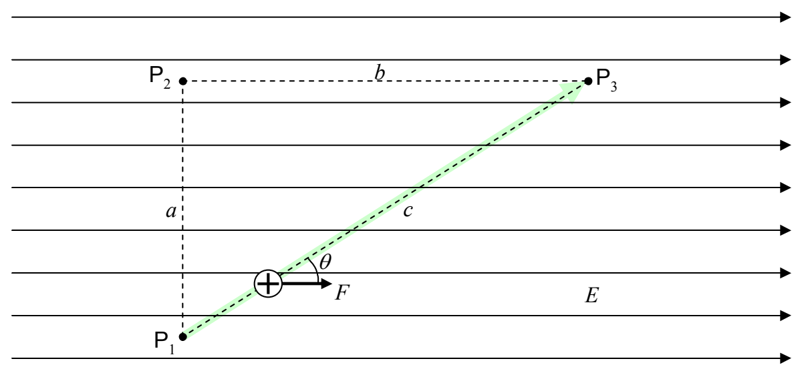

Now let's calculate the work done on the charged particle if it undergoes the same displacement (from \( \mathsf{P}_1 \) to \( \mathsf{P}_3 \)) but does so by moving along the direct path, straight from \( \mathsf{P}_1 \) to \( \mathsf{P}_3 \).

The force on a positively-charged particle being in the same direction as the electric field, the force vector makes an angle \( \theta \) with the path direction and the expression

$$
\mathcal {W} = \vec {\mathbf {F}} \cdot \vec {\Delta \mathbf {r}}
$$

for the work becomes

$$
\mathcal {W} _ {1 3} = F c \cos \theta
$$

$$
\mathcal {W} _ {1 3} = q E c \cos \theta
$$
