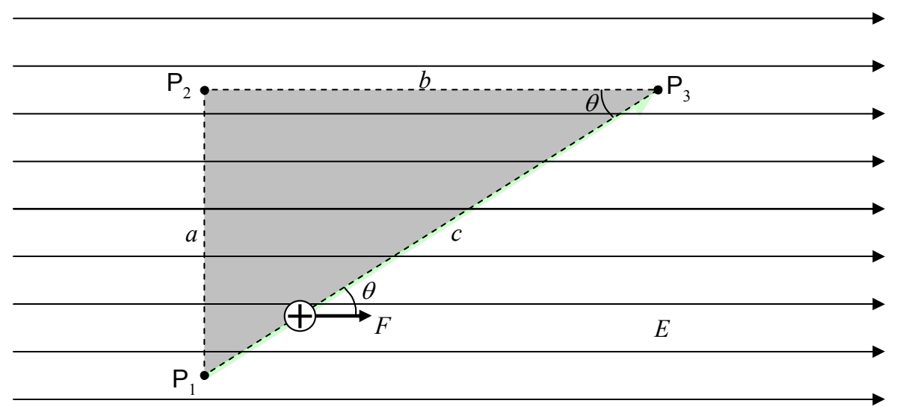

Analyzing the shaded triangle in the following diagram:

we find that $\cos\theta=\frac{b}{c}$. Substituting this into our expression for the work ($\mathcal{W}_{13}=qEc\cos\theta$) yields

$$
\mathcal{W}_{13}=qEc\frac{b}{c}
$$

$$
\mathcal{W}_{13}=qEb
$$

(This is just an answer to a sample problem.)

This is the same result we got for the work done on the charged particle by the electric field as the particle moved between the same two points (from $\mathsf{P}_1$ to $\mathsf{P}_3$) along the other path ($\mathsf{P}_1$ to $\mathsf{P}_2$ to $\mathsf{P}_3$). As it turns out, the work done is the same no matter what path the particle takes on its way from $\mathsf{P}_1$ to $\mathsf{P}_3$. I don’t want to take the time to prove that here but I would like to investigate one more path (not so much to get the result, but rather, to review an important point about how to calculate work). Referring to the diagram:
