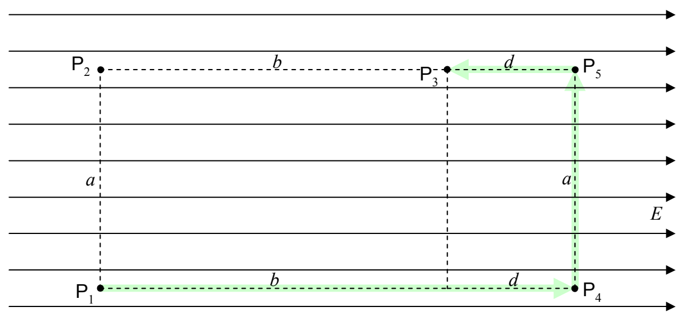

Let's calculate the work done on a particle with charge \( q \), by the electric field, as the particle moves from \( \mathsf{P}_1 \) to \( \mathsf{P}_3 \) along the path "from \( \mathsf{P}_1 \) straight to \( \mathsf{P}_4 \), from \( \mathsf{P}_4 \) straight to \( \mathsf{P}_5 \), and from \( \mathsf{P}_5 \) straight to \( \mathsf{P}_3 \)." On \( \mathsf{P}_1 \) to \( \mathsf{P}_4 \), the force is in the exact same direction as the direction in which the particle moves along the path, so,

\[
\mathcal {W} _ {1 4} = F (b + d)
\]

\[
\mathcal {W} _ {1 4} = q E (b + d)
\]

From point \( P_{4} \) to \( P_{5} \), the force exerted on the charged particle by the electric field is at right angles to the path, so, the force does no work on the charged particle on segment \( P_{4} \) to \( P_{5} \).

\[
\mathcal {W} _ {4 5} = 0
\]
