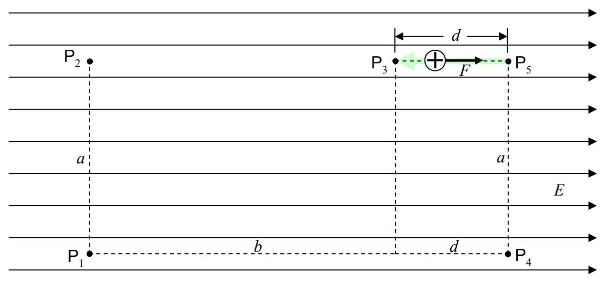

On the segment from $P_5$ to $P_3$,

the force is in the exact opposite direction to the direction in which the particle moves. This means that the work done by the force of the electric field on the charged particle as the particle moves form $P_5$ to $P_3$ is the negative of the magnitude of the force times the length of the path segment. Thus

$$\mathcal{W}_{53} = -Fd$$

$$\mathcal{W}_{53} = -qEd$$

and

$$\mathcal{W}_{1453} = \mathcal{W}_{14} + \mathcal{W}_{45} + \mathcal{W}_{53}$$

$$\mathcal{W}_{1453} = qE(b + d) + 0 + (-qEd)$$

$$\mathcal{W}_{1453} = qEb$$

(This is just an answer to a sample problem.)

As advertised, we obtain the same result for the work done on the particle as it moves from $P_1$ to $P_3$ along “$P_1$ to $P_4$ to $P_5$ to $P_3$” as we did on the other two paths.

Whenever the work done on a particle by a force acting on that particle, when that particle moves from point $P_1$ to point $P_3$, is the same no matter what path the particle takes on the way from $P_1$ to $P_3$, we can define a potential energy function for the force. The potential energy function is an assignment of a value of potential energy to every point in space. Such an assignment allows us to calculate the work done on the particle by the force when the particle moves from point $P_1$ to point $P_3$ simply by subtracting the value of the potential energy of the particle at $P_1$ from the value of the potential energy of the particle at $P_3$ and taking the negative of the result. In other words, the work done on the particle by the force of the electric field when the particle goes from one point to another is just the negative of the change in the potential energy of the particle.
