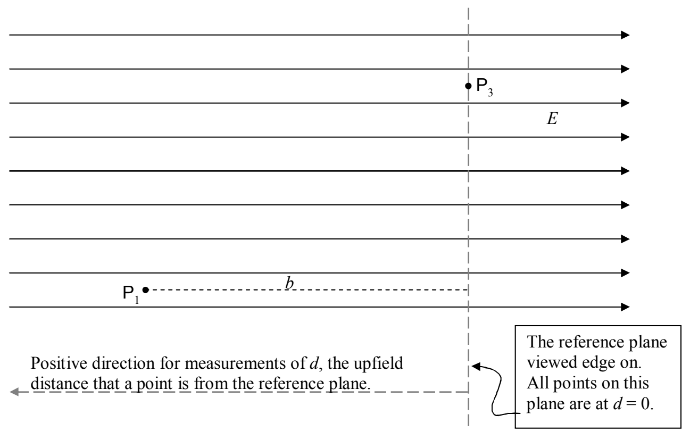

Let’s make sure this expression for the potential energy function gives the result we obtained previously for the work done on a particle with charge $q$, by the uniform electric field depicted in the following diagram, when the particle moves from $\mathsf{P}_1$ to $\mathsf{P}_3$

As you can see, I have chosen (for my own convenience) to define the reference plane to be at the most downfield position relevant to the problem. With that choice, the particle of charge $q$, when it is at $\mathsf{P}_1$ has potential energy $qEb$ (since point $\mathsf{P}_1$ is a distance $b$ “upfield” from the reference plane) and, when it is at $\mathsf{P}_3$, the particle of charge $q$ has potential energy 0 since $\mathsf{P}_3$ is on the reference plane.

$$\mathcal{W}_{13} = -\Delta U$$

$$\mathcal{W}_{13} = -(U_3 - U_1)$$

$$\mathcal{W}_{13} = -(0 - qEb)$$

$$\boxed{\mathcal{W}_{13} = qEb}$$

*(This is just an answer to a sample problem.)*

This is indeed the result we got (for the work done by the electric field on the particle with charge $q$ as that particle was moved from $\mathsf{P}_1$ to $\mathsf{P}_3$) the other three ways that we calculated this work.
