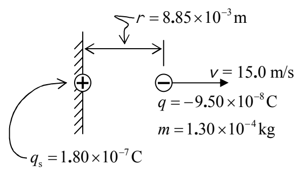
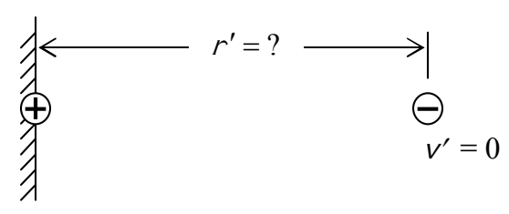

## Example

A particle of charge $0.180\ \mu\text{C}$ is fixed in space by unspecified means. A particle of charge $-0.0950\ \mu\text{C}$ and mass $0.130$ grams is $0.885$ cm away from the first particle and moving directly away from the first particle with a speed of $15.0$ m/s. How far away from the first particle does the second particle get?

This is a conservation of energy problem. As required for all conservation of energy problems, we start with a before and after diagram:

Before

After

Energy Before = Energy After

$$K + U = K' + U'$$

$$K + q\varphi = \overset{0}{\cancel{K'}} + q\varphi'$$

$$\frac{1}{2}mv^2 + q\frac{kq_s}{r} = q\frac{kq_s}{r'}$$

$$\frac{1}{r'} = \frac{1}{r} + \frac{mv^2}{2kq_s q}$$

$$r' = \frac{1}{\frac{1}{r} + \frac{mv^2}{2kq_s q}}$$

$$r' = \frac{1}{\frac{1}{8.85 \times 10^{-3}\ \text{m}} + \frac{1.30 \times 10^{-4}\ \text{kg}\ (15.0\ \text{m/s})^2}{2\left(8.99 \times 10^9\ \frac{\text{N} \cdot \text{m}^2}{\text{C}^2}\right) 1.80 \times 10^{-7}\ \text{C}\ (-9.50 \times 10^{-8}\ \text{C})}}$$

$$r' = 0.05599\ \text{m}$$

$$r' = 0.0560\ \text{m}$$

$$\boxed{r' = 5.60\ \text{cm}}$$
