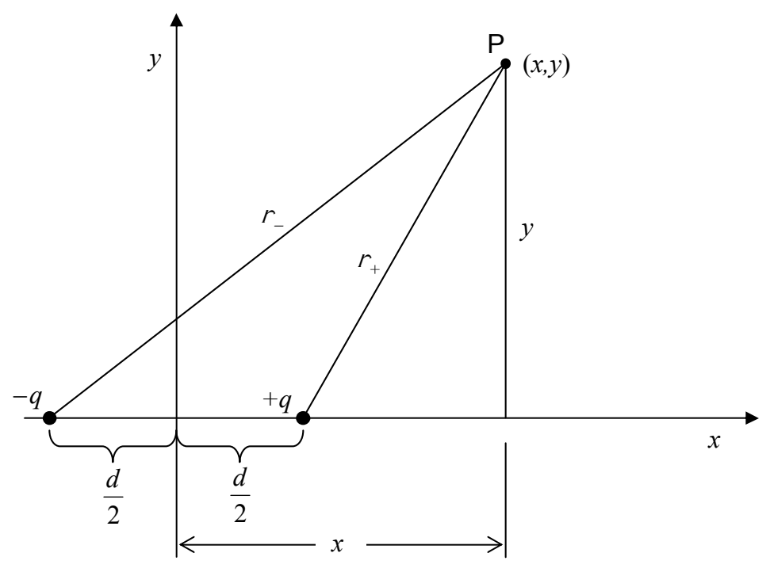

## Superposition in the Case of the Electric Potential

When there is more than one charged particle contributing to the electric potential at a point in space, the electric potential at that point is the sum of the contributions due to the individual charged particles. The electric potential at a point in space, due to a set of several charged particles, is easier to calculate than the electric field due to the same set of charged particles is. This is true because the sum of electric potential contributions is an ordinary arithmetic sum, whereas, the sum of electric field contributions is a vector sum.

## Example

Find a formula that gives the electric potential at any point  $(x, y)$  on the x-y plane, due to a pair of particles: one of charge -q at  $\left(-\frac{d}{2}, 0\right)$  and the other of charge +q at  $\left(\frac{d}{2}, 0\right)$ .

Solution: We establish a point P at an arbitrary position (x, y) on the x-y plain and determine the distance that point P is from each of the charged particles. In the following diagram, I use the symbol  $r_{+}$ to represent the distance that point P is from the positively-charged particle, and  $r_{-}$ to represent the distance that point P is from the negatively-charged particle.

