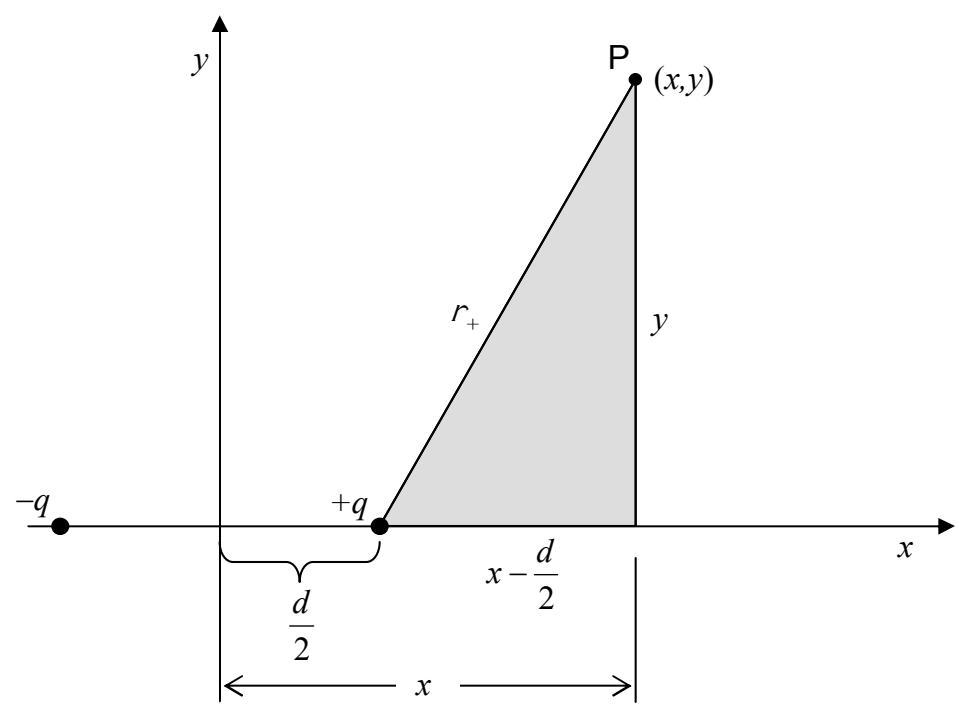
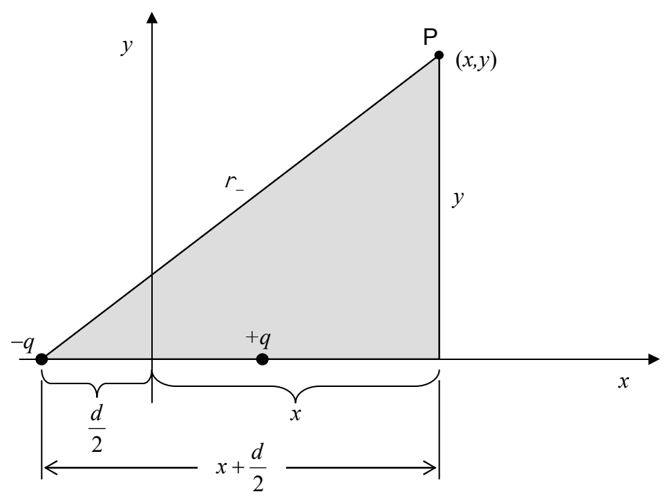

Analysis of the shaded triangle in the diagram at right gives us  $r_{+}$ .

$$r _ {+} = \sqrt {\left(x - \frac {d}{2}\right) ^ {2} + y ^ {2}}$$

Analysis of the shaded triangle in the diagram at right gives us  $r_{-}$ .

$$r _ {-} = \sqrt {\left(x + \frac {d}{2}\right) ^ {2} + y ^ {2}}$$

