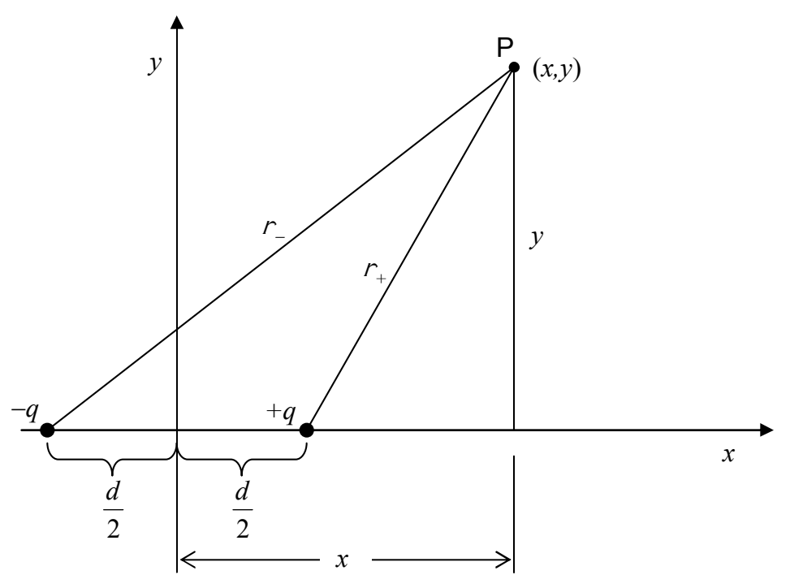

With the distances that point P is from each of the charged particles in hand, we are ready to determine the potential:

$$r _ {+} = \sqrt {\left(x - \frac {d}{2}\right) ^ {2} + y ^ {2}}$$

$$r _ {-} = \sqrt {\left(x + \frac {d}{2}\right) ^ {2} + y ^ {2}}$$

$$\varphi (x, y) = \varphi_ {+} + \varphi_ {-}$$

$$\varphi (x, y) = \frac {k q}{r _ {+}} + \frac {k (- q)}{r _ {-}}$$

$$\varphi (x, y) = \frac {k q}{r _ {+}} - \frac {k q}{r _ {-}}$$

$$\varphi (x, y) = \frac {k q}{\sqrt {\left(x - \frac {d}{2}\right) ^ {2} + y ^ {2}}} - \frac {k q}{\sqrt {\left(x + \frac {d}{2}\right) ^ {2} + y ^ {2}}}$$
