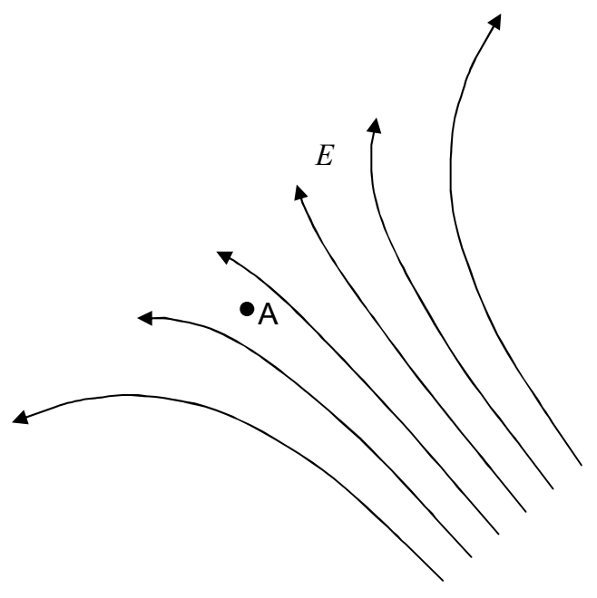

## 7 Equipotential Surfaces, Conductors, and Voltage

Consider a region of space in which there exists an electric field. Focus your attention on a specific point in that electric field, call it point A.

Imagine placing a positive test charge at point A. (Assume that, by means not specified, you can move the test charge anywhere you want to.) Please think about the answer to the following question before reading on: Is it possible for you to move the test charge around in the electric field in such a manner that the electric field does no work on the test charge?

If we move the positive test charge in the “downfield” direction (toward the upper left corner of the diagram), there will be a positive amount of work (force-along-the-path times the length of the path) done on the test charge. And, if we move the positive test charge in the “upfield” direction there will be a negative amount of work done on it. But, if we move the positive test charge at right angles to the electric field, no work is done on it. That is, if we choose a path for the positive test charge such that every infinitesimal displacement of the particle is normal to the electric field at the location of the particle when it (the particle) undergoes said infinitesimal displacement, then the work done on the test charge, by the electric field, is zero. The set of all points that can be reached by such paths makes up an infinitesimally thin shell, a surface, which is everywhere perpendicular to the electric field. In moving a test charge along the surface from one point (call it point A) to another point (call it point B) on the surface, the work done is zero because the electric field is perpendicular to the path at all points along the path. Let’s (momentarily) call the kind of surface we have been discussing a “zero-work surface.” We have constructed the surface by means of force-along-the-path times the length-of-the-path work considerations. But the work done by the electric field when a test charge is moved from point A on the surface to point B on the surface must also turn out to be zero if we calculate it as the
