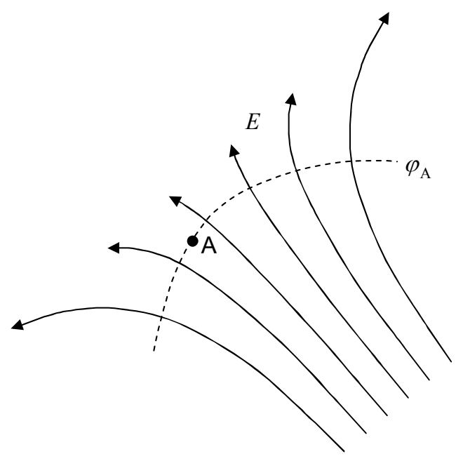

negative of the change in the potential energy of the test charge. Let's do that and see where it leads us. We know that the work $\mathcal{W} = 0$.

Also

$$\mathcal{W} = -\Delta U$$

$$\mathcal{W} = -(U_\mathrm{B} - U_\mathrm{A})$$

In terms of the electric potential $\varphi$, $U = q\varphi$ so the work can be expressed as

$$\mathcal{W} = -(q\varphi_\mathrm{B} - q\varphi_\mathrm{A})$$

$$\mathcal{W} = -q(\varphi_\mathrm{B} - \varphi_\mathrm{A})$$

Given that $\mathcal{W} = 0$, this means that

$$0 = -q(\varphi_\mathrm{B} - \varphi_\mathrm{A})$$

$$\varphi_\mathrm{B} - \varphi_\mathrm{A} = 0$$

$$\varphi_\mathrm{B} = \varphi_\mathrm{A}$$

This is true for any point B on the entire “zero-work” surface. This means that every point on the entire surface is at the same value of electric potential. Thus a “zero-work” surface is also an equipotential surface. Indeed, this is the name (equipotential surface) that physicists use for such a surface. An equipotential surface is typically labeled with the corresponding potential value ($\varphi_\mathrm{A}$ in the case at hand). In the following diagram, the dashed curve represents the equipotential surface viewed edge on.

