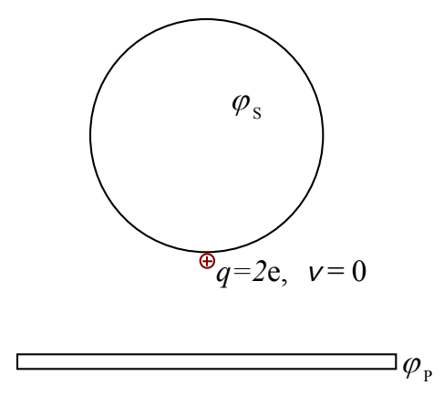
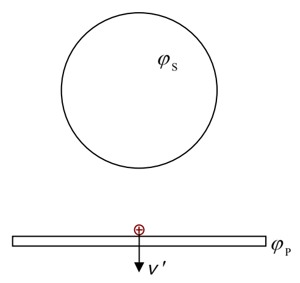

## Example 7-1

A hollow metal sphere is at a potential that is 472 volts higher than that of a nearby metal plate. A particle of charge 2e is released from rest at the surface of the sphere. It subsequently strikes the plate. With what kinetic energy does the charged particle strike the plate? (Assume that the only force acting on the particle is that due to the electric field corresponding to the given information.)

BEFORE

AFTER

(Given $\varphi_{\text{S}} - \varphi_{\text{P}} = \Delta\varphi = 472$ volts.)

Energy Before = Energy After

$$\overset{0}{\cancel{K}} + U = K' + U'$$

$$q\varphi_S = K' + q\varphi_P$$

$$K' = q\varphi_S - q\varphi_P$$

$$K' = q(\varphi_S - \varphi_P)$$

$$K' = q\,\Delta\varphi$$

$$K' = 2e\ (472\ \text{volts})$$

$$\boxed{K' = 944\ \text{eV}}$$

Note that in the solution to the example problem, we never needed to know the value of the electric potential of either the sphere or the plate, only the difference between the two potentials. There is a device which can be used to measure the potential difference between two points in space. The device is called a voltmeter. A typical voltmeter consists of a box with two wires extending from it. On the end of each wire is a short metal wand called a probe. Each wire and each probe, except for the tip of the probe, is covered with insulating material. The box displays, either by means of a digital readout or the position of a needle, the potential difference between
