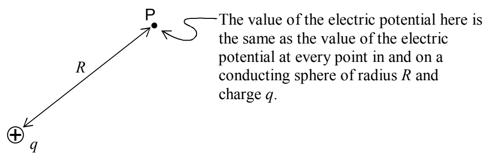

indistinguishable from the electric field due to a point charge q at the position of the center of the sphere; and; everywhere inside the surface of the sphere, the electric field is zero. Thus, outside the sphere, the electric potential must be identical to the electric potential due to a point charge at the center of the sphere (instead of the sphere). Working your way in from infinity, however, as you pass the surface of the sphere, the electric potential no longer changes. Whatever the value of electric potential at the surface of the sphere is, that is the value of electric potential at every point inside the sphere.

This means that the electric potential of the sphere is equal to the electric potential that would be caused by a point charge (all by itself) at a point in space a distance R from the point charge (where R is the radius of the sphere).

Thus,  $\varphi=\frac{kq}{R}$  is the electric potential of a conducting sphere of radius R and charge q.

Solving this expression for $\frac{q}{\varphi}$ yields:

$$\frac {q}{\varphi} = \frac {R}{k}$$

Since, by definition, the capacitance $C_{\mathrm{sc}} = \frac{q}{\varphi}$, we have:

$$C _ {\mathrm{sc}} = \frac {R}{k} \tag {8-2}$$

The capacitance of a conducting sphere is directly proportional to the radius of the sphere. The bigger the sphere, the more charge you have to put on it to raise its potential one volt (in other words, the bigger the capacitance of the sphere). This is true of conducting objects in general. Since all the unbalanced charge on a conductor resides on the surface of the conductor, it really has to do with the amount of surface area of the object. The more surface area, the more room
