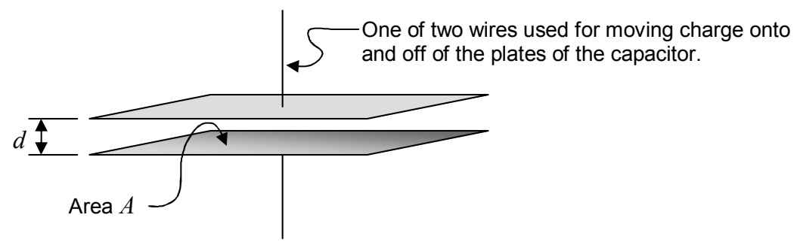

repositioning of the charge, there is a potential difference between the two conductors. This potential difference $\Delta \varphi$ is called the voltage of the capacitor or, more often, the voltage across the capacitor. We use the symbol $V$ to represent the voltage across the capacitor. In other words, $V \equiv \Delta \varphi$. The ratio of the amount of charge moved from one conductor to the other, to, the resulting potential difference of the capacitor, is the capacitance of the capacitor (the pair of conductors separated by vacuum or insulator).

$$C = \frac{q}{V} \tag{8-3}$$

where:

$C$ is the capacitance of a capacitor, a pair of conductors separated by vacuum or an insulating material,

$q$ is the “charge on the capacitor,” the amount of charge that has been moved from one initially neutral conductor to the other. One conductor of the capacitor actually has an amount of charge $q$ on it and the other actually has an amount of charge $-q$ on it.

$V$ is the electric potential difference $\Delta \varphi$ between the conductors. It is known as the voltage of the capacitor. It is also known as the voltage across the capacitor.

A two-conductor capacitor plays an important role as a component in electric circuits. The simplest kind of capacitor is the parallel-plate capacitor. It consists of two identical sheets of conducting material (called plates), arranged such that the two sheets are parallel to each other. In the simplest version of the parallel-plate capacitor, the two plates are separated by vacuum.

The capacitance of such a capacitor is given by

$$C = \epsilon_{\mathrm{o}} \frac{A}{d}$$

where:

$C$ is the capacitance of the parallel-plate capacitor whose plates are separated by vacuum,

$d$ is the distance between the plates,

$A$ is the area of one face of one of the plates,

$\epsilon_{\mathrm{o}}$ is a universal constant called the permittivity of free space. $\epsilon_{\mathrm{o}}$ is closely related to the Coulomb constant $k$. In fact, $k = \frac{1}{4\pi\epsilon_{\mathrm{o}}}$. Thus, $\epsilon_{\mathrm{o}} = 8.85 \times 10^{-12} \frac{\mathrm{C}^{2}}{\mathrm{N} \cdot \mathrm{m}^{2}}$. Our equation for the capacitance can be expressed in terms of the Coulomb constant $k$ as $C = \frac{1}{4\pi k} \frac{A}{d}$, but, it is more conventional to express the capacitance in terms of $\epsilon_{\mathrm{o}}$.
