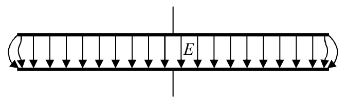
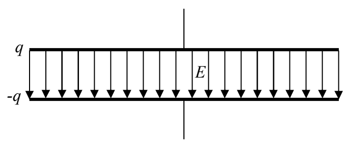

This equation for the capacitance is an approximate formula. It is a good approximation as long as the plate separation $d$ is small compared to a representative plate dimension (the diameter in the case of circular plates, the smaller edge length in the case of rectangular plates). The derivation of the formula is based on the assumption that the electric field, in the region between the plates is uniform, and the electric field outside that region is zero. In fact, the electric field is not uniform in the vicinity of the edges of the plates. As long as the region in which the electric field is not well-approximated by a uniform electric field is small compared to the region in which it is, our formula for the capacitance is good.

## The Effect of Insulating Material Between the Plates of a Capacitor

To get at the effect of insulating material, rather than vacuum, between the plates of a capacitor, I need to at least outline the derivation of the formula $C = \epsilon_o \frac{A}{d}$. Keep in mind that the capacitance is the charge-per-voltage of the capacitor. Suppose that we move charge $q$ from one initially-neutral plate to the other. We assume that the electric field is uniform between the plates of the capacitor and zero elsewhere.

V (the potential difference between the plates, a.k.a. the voltage across the capacitor)

By means that you will learn about later in this book we establish that the value of the electric field (valid everywhere between the plates) is given by:

$$E = \frac{q}{A \epsilon_o} \tag{8-4}$$

Also, we know that the work done on a test charge $q_T$ by the electric field when the test charge is moved from the higher-potential plate to the lower-potential plate is the same whether we calculate it as force-along the path times the length of the path, or, as the negative of the change
