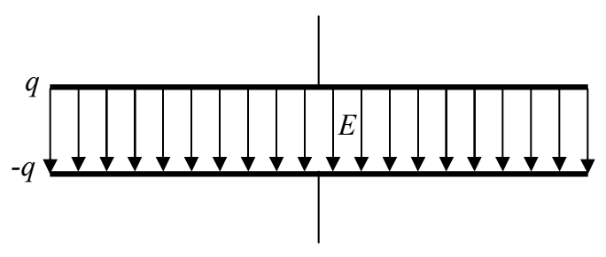
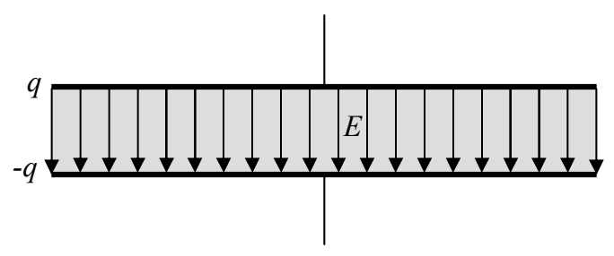
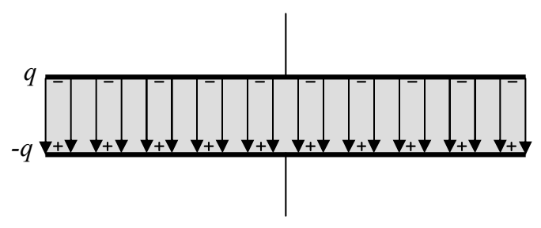
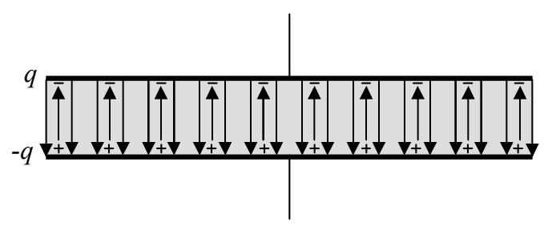

Starting with vacuum between the plates,

we insert some insulating material:

The original electric field polarizes the insulating material:

The displaced charge creates an electric field of its own, in the direction opposite that of the original electric field:

