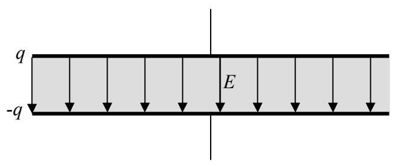

The net electric field, being at each point in space, the vector sum of the two contributions to it, is in the same direction as the original electric field, but weaker than the original electric field:

This is what we wanted to show. The presence of the insulating material makes for a weaker electric field (for the same charge on the capacitor), meaning a smaller potential difference, meaning a bigger charge-to-voltage ratio, meaning a bigger capacitance. How much bigger depends on how much the insulator is polarized which depends on what kind of material the insulator consists of. An insulating material, when placed between the plates of a capacitor is called a dielectric. The net effect of using a dielectric instead of vacuum between the plates is to multiply the capacitance by a factor known as the dielectric constant. Each dielectric is characterized by a unitless dielectric constant specific to the material of which the dielectric is made. The capacitance of a parallel-plate capacitor which has a dielectric in between the plates, rather than vacuum, is just the dielectric constant $\kappa$ times the capacitance of the same capacitor with vacuum in between the plates.

$$C = \kappa \epsilon_{\mathrm{o}} \frac{A}{d} \tag{8-5}$$

where:

$C$ is the capacitance of the parallel-plate capacitor whose plates are separated by an insulating material,

$\kappa$ is the dielectric constant characterizing the insulating material between the plates,

$d$ is the distance between the plates,

$A$ is the area of one face of one of the plates, and

$\epsilon_{\mathrm{o}}$ is a universal constant called the permittivity of free space.

Calling the dielectric constant for vacuum 1 (exactly one), we can consider this equation to apply to all parallel-plate capacitors. Some dielectric constants of materials used in manufactured capacitors are provided in the following table:

| Substance | Dielectric Constant |
| :--- | :--- |
| Air | 1.00 |
| Aluminum Oxide (a corrosion product found in many electrolytic capacitors) | 7 |
| Mica | 3-8 |
| Titanium Dioxide | 114 |
| Vacuum | 1 (exactly) |
| Waxed Paper | 2.5-3.5 |
