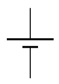
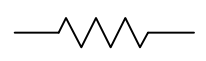
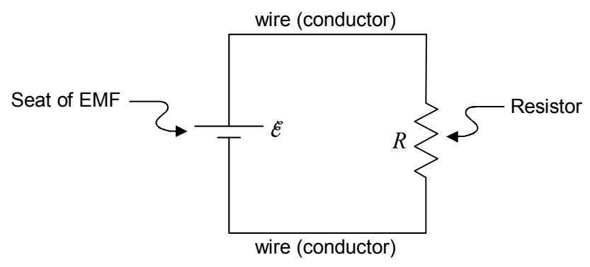

You’ll recall that electric potential is something that is used to characterize an electric field. In causing there to be a potential difference between its terminals and between any pair of wires that might be connected to its terminals, the seat of EMF creates an electric field. The electric field depends on the arrangement of the wires that are connected to the terminals of the seat of EMF. The electric field is another quantity that we rarely discuss in analyzing circuits. We can typically find out what we need to find out from the value of the potential difference $\mathcal{E}$ that the seat of EMF maintains between its terminals. But, the electric field does exist, and, in circuits, the electric field of the charge on the wires connected to the seat of EMF is what causes charge to flow in a circuit, and charge flow in a circuit is a huge part of what a circuit is all about.

We use the symbol

to represent a seat of EMF in a circuit diagram (a.k.a. a schematic diagram of a circuit) where the two collinear line segments represent the terminals of the seat of EMF, the one connected to the shorter of the parallel line segments being the negative, lower-potential, terminal; and; the one connected to the longer of the parallel line segments being the positive, higher-potential, terminal.

The other circuit element that I want to introduce in this chapter is the *resistor*. A resistor is a poor conductor. The resistance of a resistor is a measure of how poor a conductor the resistor is. The bigger the value of resistance, the more poorly the circuit element allows charge to flow through itself. Resistors come in many forms. The filament of a light bulb is a resistor. A toaster element (the part that glows red when the toaster is on) is a resistor. Humans manufacture small ceramic cylinders (with a coating of carbon and a wire sticking out each end) to have certain values of resistance. Each one has its value of resistance indicated on the resistor itself. The symbol

is used to represent a resistor in a circuit diagram. The symbol $R$ is typically used to represent the value of the resistance of a resistor.

We are now ready to consider the following simple circuit:

