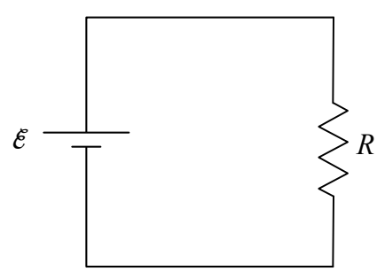
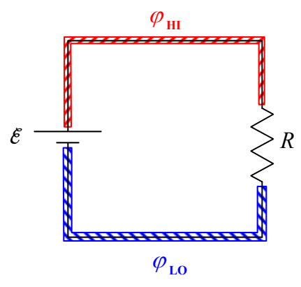
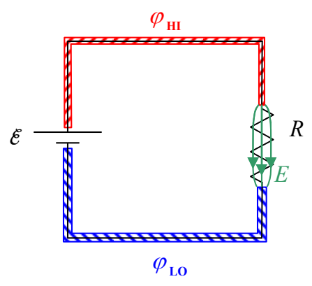

Here it is again without so many labels:

The upper wire (conductor) has one value of electric potential (call it $\varphi_{\text{HI}}$) and the lower wire has another value of electric potential (call it $\varphi_{\text{LOW}}$) such that the difference $\varphi_{\text{HI}} - \varphi_{\text{LOW}}$ is $\mathcal{E}$.

$$\varphi_{\text{HI}} - \varphi_{\text{LOW}} = \mathcal{E}$$

In order to maintain the potential difference $\mathcal{E}$ between the two conductors, the seat of EMF causes there to be a minuscule amount of positive charge on the upper wire and the same amount of negative charge on the lower wire. This charge separation causes an electric field in the resistor.

