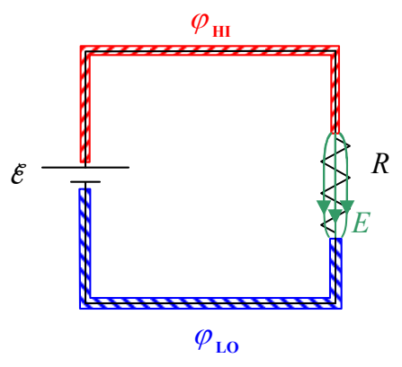

(We carry out this argument in the positive charge carrier model. While it makes no difference for the circuit, as a point of fact, it is actually negatively charged particles moving in the opposite direction. The effect is the same.)

It is important to realize that every part of the circuit is chock full of both kinds of charge. The wire, the resistor, everything is incredibly crowded with both positive and negative charge. One kind of charge can move against the background of the other. Now the electric field in the resistor pushes the positive charge in the resistor in the direction from the higher-potential terminal toward the lower-potential terminal.

Pushing positive charge onto the lower-potential wire would tend to raise the potential of the lower-potential wire and leave the upper end of the resistor with a negative charge. I say “would” because any tendency for a change in the relative potential of the two wires is immediately compensated for by the seat of EMF. Remember, that’s what the seat of EMF does, it maintains a constant potential difference between the wires. To do so in the case at hand, the seat of EMF must pull some positive charges from the lower-potential wire and push them onto the higher-potential wire. Also, any tendency of the upper end of the resistor to become negative immediately results in an attractive force on the positive charge in the higher-potential wire. This causes that positive charge to move down into the resistor in the place of the charge that just moved along the resistor toward the lower-potential wire. The net effect is a continual movement of charge, clockwise around the loop, as we view it in the diagram, with the net amount of charge in any short section of the circuit never changing. Pick a spot anywhere in the circuit. Just as fast as positive charge moves out of that spot, more positive charge from a neighboring spot moves in. What we have is this whole crowded mass of positive charge carriers moving clockwise around the loop, all because of the electric field in the resistor, and the EMF’s “insistence” on maintaining a constant potential difference between the wires.
