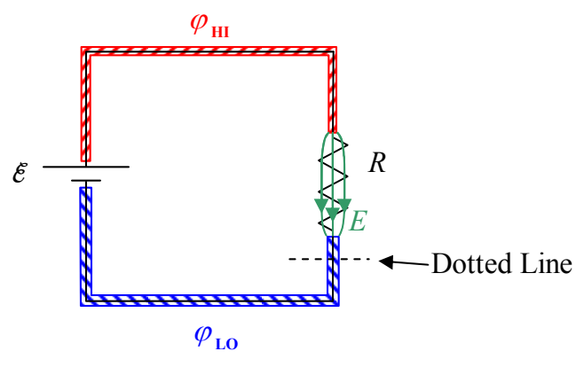
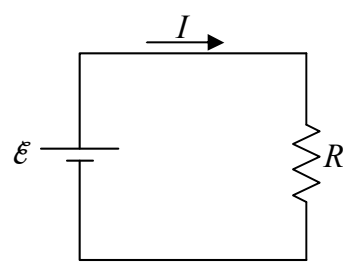

Now draw a dotted line across the path of the circuit, at any point in the circuit, as indicated below.

The rate at which charge crosses that line is the charge flow rate at that point (the point at which you drew the dotted line) in the circuit. The charge flow rate, how many coulombs-of-charge-per-second are crossing that line is called the electric current at that point. In the case at hand, because the whole circuit consists of a single loop, the current is the same at every point in the circuit—it doesn’t matter where you “draw the line.” The symbol that one typically uses to represent the value of the current is $I$.

In analyzing a circuit, if the current variable is not already defined for you, you should define it by drawing an arrow on the circuit and labeling it I or I with a subscript.

The units for current are coulombs per second (C/s). That combination of units is given a name: the ampere, abbreviated A.

$$1 \mathrm{A} = 1 \frac {\mathrm{C}}{\mathrm{s}}$$

Now about that resistor: In our positive charge carrier model, the charged particles that are free to move in the resistor experience a force exerted on them by the electric field, in the direction of the electric field. As a result, they experience acceleration. But, the background material making up the substance of which the charge carriers are a part, exerts a velocity-dependent retarding force on the charge carriers. The faster they go, the bigger the retarding force. Upon completion of the circuit (making that final wire-to-terminal connection), the charge carriers in the resistor, almost instantaneously, reach a terminal velocity at which the retarding force on a given charge carrier is
