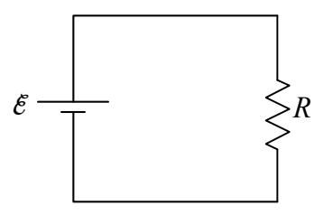

just as great as the force exerted by the electric field on that charge carrier. The value of the terminal velocity, along with the number-of-charge-carriers-per-volume in the resistor, and the cross-sectional area of the poorly-conducting material making up the resistor, determine the charge flow rate, the current, in the resistor. In the simple circuit under consideration, the charge flow rate in the resistor is the charge flow rate everywhere in the circuit.

The value of the terminal velocity itself depends on how strong the electric field is, and, on the nature of the retarding force. The nature of the retarding force depends on what kind of material the resistor is made of. One kind of material will result in a bigger terminal velocity for the same electric field as another kind of material. Even with one kind of material, there's the question of how the retarding force depends on the velocity. Is it proportional to the square of the velocity, the log of the velocity, or what? Experiment shows that in an important subset of materials, over certain ranges of the terminal velocity, the retarding force is proportional to the velocity itself. Such materials are said to obey Ohm's law and are referred to as ohmic materials.

Consider the resistor in the simple circuit we have been dealing with.

If you double the voltage across the resistor (by using a seat of EMF that maintains twice the potential difference between its terminals as the original seat of EMF) then you double the electric field in the resistor. This doubles the force exerted on each charge carrier. This means that, at the terminal velocity of any charge carrier, the retarding force has to be twice as great. (Since, upon making that final circuit connection, the velocity of the charge carriers increases until the retarding force on each charge carrier is equal in magnitude to the applied force.) In an ohmic material, if the retarding force is twice as great, then the velocity is twice as great. If the velocity is twice as great, then the charge flow rate, the electric current, is twice as great. So, doubling the voltage across the resistor doubles the current. Indeed, for a resistor that obeys Ohm's Law, the current in a resistor is directly proportional to the voltage across the resistor.

Summarizing: When you put a voltage across a resistor, there is a current in that resistor. The ratio of the voltage to the current is called the resistance of the resistor.

$$R = \frac {V}{I}$$

This definition of resistance is consistent with our understanding that the resistance of a resistor is a measure of how lousy a conductor it is. Check it out. If, for a given voltage across the resistor, you get a tiny little current (meaning the resistor is a very poor conductor), the value of resistance  $R = \frac{V}{I}$  with that small value of current in the denominator, is very big. If, on the
