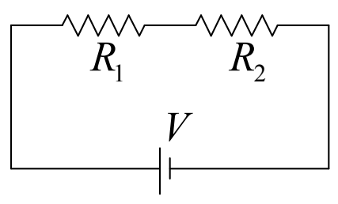
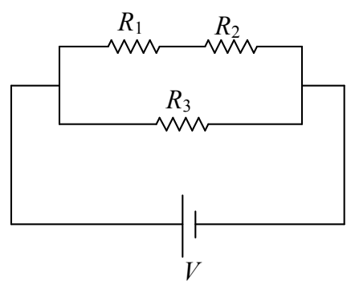

## 10 Resistors in Series and Parallel; Measuring / & V

The analysis of a circuit involves the determination of the voltage across, and the current through, circuit elements in that circuit. A method that I call “the method of ever simpler circuits” can be used to simplify the analysis of many circuits that have more than one resistor. The method involves the replacement of a combination of resistors with a single resistor, carefully chosen so that the replacement does not change the voltage across, nor the current through, the other circuit elements in the circuit. The resulting circuit is easier to analyze, and, the results of its analysis apply to the original circuit. Because the single carefully-chosen resistor has the same effect on the rest of the circuit as the original combination of resistors, we call the single resistor the equivalent resistance of the combination, or, simply, the equivalent resistor.

## Resistors in Series

One combination of resistors that can be replaced with a single effective resistor is a series combination of resistors. Two two-terminal circuit elements in a circuit are in series with each other when one end of one is connected with one end of the other with nothing else connected to the connection $^{1}$ . For instance,  $R_{1}$  and  $R_{2}$  in the following circuit are in series with each other.

From our viewpoint, the right end of  $R_{1}$  is connected to the left end of  $R_{2}$  and nothing else is connected to the point in the circuit where they are connected.

$R_{1}$ and $R_{2}$ in the following circuit are also in series with each other:

$^{1}$  Here we have described adjacent resistors that are in series. Non-adjacent two-terminal circuit elements are also in series with each other if each is in series with a third two-terminal circuit element. In this definition, in addition to an ordinary two-terminal circuit element such as a seat of EMF or a resistor, a two-terminal combination of circuit elements is considered to be a two-terminal circuit element.
