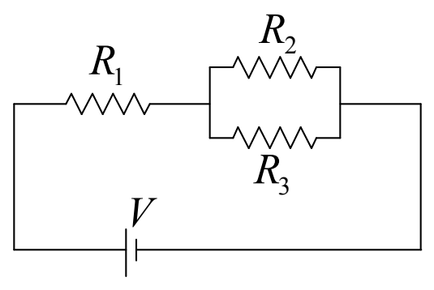

But, $R_1$ and $R_2$ in the following circuit are not in series with each other:

While it is true that the right end of $R_1$ is connected to the left end of $R_2$, it is not true that “nothing else is connected to the connection.” Indeed, the left end of $R_3$ is connected to the point in the circuit at which $R_1$ and $R_2$ are connected to each other.

In implementing the method of ever simpler circuits, the plan is to replace a combination of resistors that are in series with each other with a single, well-chosen equivalent resistor. The question is, what value must the resistance of the single resistor be in order for it to be equivalent to the set of series resistors it replaces? For now, we simply give you the result. The derivation will be provided in the next chapter.

The equivalent resistance of resistors in series is simply the sum of the resistances.

$$R_S = R_1 + R_2 + R_3 + \ldots$$
