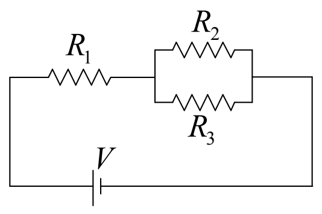
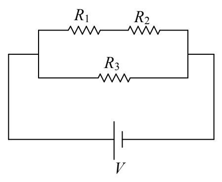
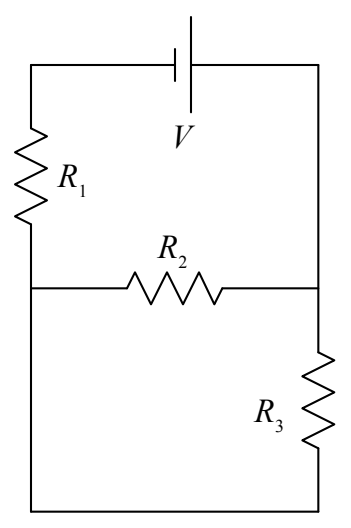

## Resistors in Parallel

Circuit elements are in parallel with each other if they are connected together (by nothing but “perfect” conductor) at both ends. So, for instance,  $R_{2}$  and  $R_{3}$  in the following circuit:

are in parallel with each other.

On the other hand,  $R_{1}$  and  $R_{3}$  in the following circuit

are not in parallel with each other.

Resistors  $R_{2}$  and  $R_{3}$  in the following circuit are in parallel with each other:

