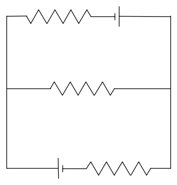
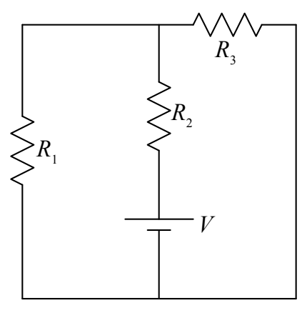

But, none of the resistors in the following circuit are in parallel with each other:

whereas $R_1$ and $R_3$ in the following circuit are in parallel with each other:

So what is the equivalent resistor for resistors in parallel? Here we provide the result. We save the derivation for the next chapter.

The equivalent resistance of resistors in parallel is the reciprocal of the sum of the reciprocals of the resistances of the resistors making up the parallel combination:

$$R_P = \frac{1}{\frac{1}{R_1} + \frac{1}{R_2} + \frac{1}{R_3} + \ldots}$$
