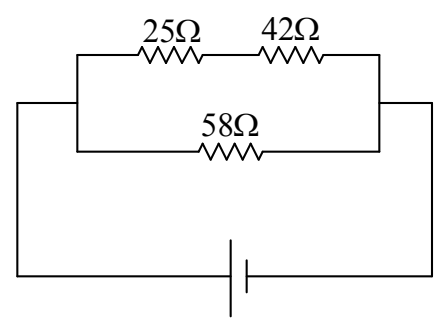
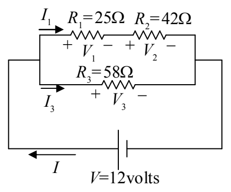

## Example

Find the voltage across, and the current through, each of the circuit elements in the diagram below.

12volts

## Solution

First we add some notation to the diagram to define our variables (do not omit this step):

1

The + and - signs on the resistors (indicating the high potential side and the low potential side of each resistor), are an important part of the definition of the voltages. If you are given values, and the value you calculate for $V_{1}$ turns out to be positive, e.g. +5.0 volts, then the reader of your solution knows that the potential of the left end of $R_{1}$ is 5.0 volts higher than that of the right end. But, if the value that you calculate for $V_{1}$ is negative, e.g. -5.0 volts, then the reader knows that the potential of the left end of $R_{1}$ is 5.0 volts lower than that of the right end.

The “+” and “−” labels on the resistors must be consistent with the current direction. In fact, one first draws and labels the current arrows, and then puts the “+” on the end of the resistor that the current enters (and the “−” on the other end).

Next we draw a sequence of circuits. Each new diagram includes an equivalent resistor in place of one series combination or one parallel combination. (Do not omit any diagrams, and, do not replace anything more than a single series combination or a single parallel combination of resistors in any one step.) As you draw each circuit, calculate the value of the equivalent resistance.
