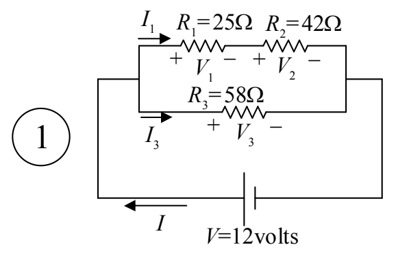
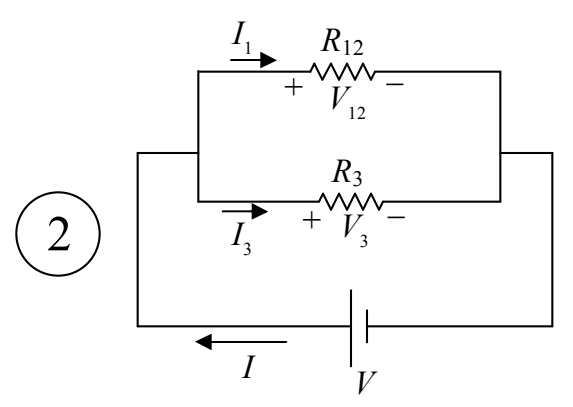
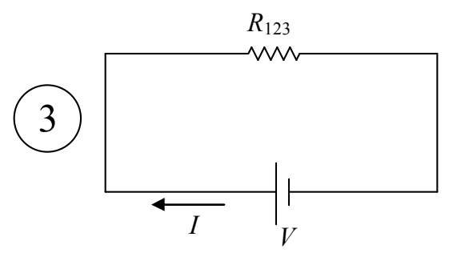

First, we copy the diagram from the preceding page.

Next, we replace the series combination of $R_{1}$ and $R_{2}$ with the equivalent resistor $R_{12}$.

$$R _ {1 2} = R _ {1} + R _ {2}$$

$$R _ {1 2} = 2 5 \Omega + 4 2 \Omega$$

$$R _ {1 2} = 6 7 \Omega$$

Finally, we replace the parallel combination of  $R_{12}$  and  $R_{3}$  with the equivalent resistor  $R_{123}$ .

$$R _ {1 2 3} = \frac {1}{\frac {1}{R _ {1 2}} + \frac {1}{R _ {3}}}$$

$$R _ {1 2 3} = \frac {1}{\frac {1}{6 7 \Omega} + \frac {1}{5 8 \Omega}}$$

$$R _ {1 2 3} = 3 1. 1 \Omega$$
