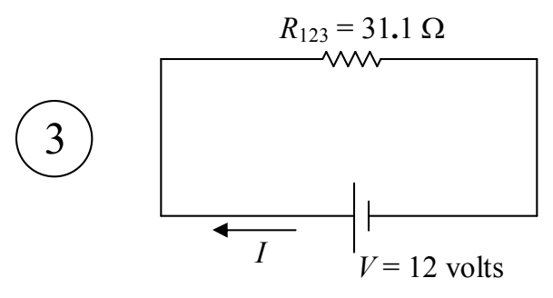

Now we analyze the simplest circuit, the one I have labeled “3” above.

One of the most common mistakes that folks make in analyzing circuits is using any old voltage in $V = IR$. You have to use the voltage across the resistor. In analyzing circuit 3, however, we can use the one voltage in the diagram because the voltage across the seat of EMF *is* the voltage across the resistor. The terminals of the resistor are connected to the same two conductors that the terminals of the seat of EMF are connected to. Thus,

$$V = IR_{123}$$

$$I = \frac{V}{R_{123}}$$

$$I = \frac{12\ \text{volts}}{31.1\ \Omega}$$

$$I = 0.386\ \text{A}$$

At this point, we’ve got two of the answers. The voltage across the seat of EMF was asked for, but it is also given, so we don’t have to show any work for it. And now we have the current through the seat of EMF.

$$\boxed{\begin{array}{l} V = 12\ \text{volts} \\ I = 0.39\ \text{amperes} \end{array}}$$

Note that the arrow labeled $I$ in our diagram is part of our answer. It tells the reader what $I$ means, including the direction of charge flow for a positive value of $I$.
