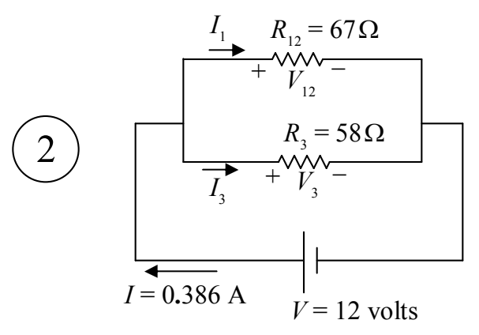
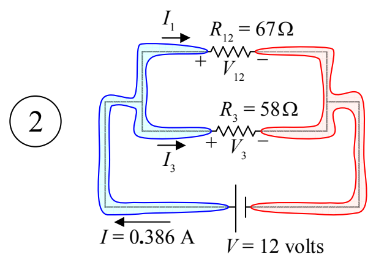

Our next step is to take the information that we have learned here, to our next more complicated circuit. That would be the one I labeled “2” above.

There are only two wires (conductors) in this circuit. I am going to highlight them in order to make my next point:

Highlighting the conductors makes it obvious that the voltage across $R_{12}$ is the same as the voltage across the seat of EMF because, in both cases, the voltage is the potential difference between one and the same pair of conductors. Likewise, the voltage across $R_3$ is the same as the voltage across the seat of EMF. Hence, we have,

$$V_{12} = V$$

$$V_{12} = 12 \text{ volts}$$

and,

$$V_3 = V$$

$$V_3 = 12 \text{ volts.}$$
