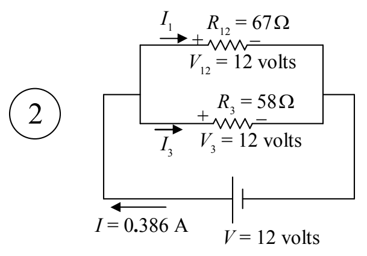

The last value is one of our answers. We were supposed to find $V_{3}$. Now that we know the voltage across $R_{3}$, we can use it in $V =IR$ to get $I_{3}$.

For resistor $R_{3}$, we have:

$$
V_{3} = I_{3}R_{3}
$$

$$
I_{3} = \frac{V_{3}}{R_{3}}
$$

$$
I_{3} = \frac{12 \text{ volts}}{58 \Omega}
$$

$$
I_{3} = \frac{12 \text{ volts}}{58 \Omega}
$$

$$
I_{3} = 0.207 \mathrm{A}
$$

The voltage and current through resistor $R_{3}$ are answers to the problem:

<table><tr><td>$V_{3} = 12$ volts</td></tr><tr><td>$I_{3} = 0.21$ amperes</td></tr></table>
