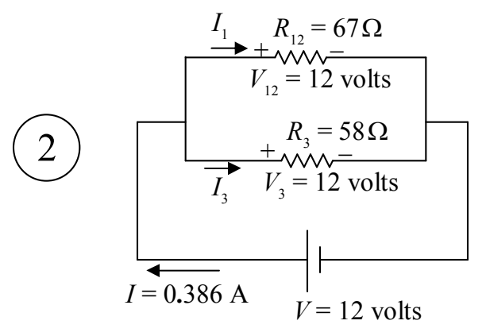
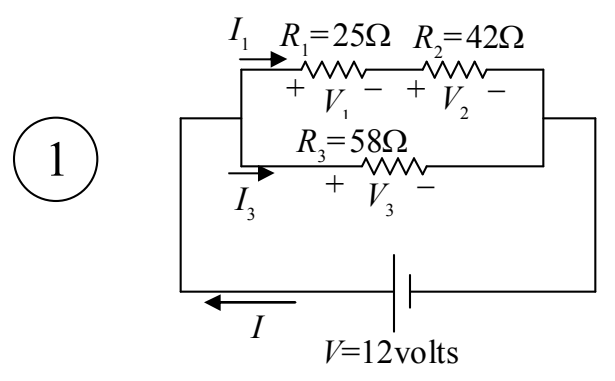

Now let's get the current through $R_{12}$. I've labeled that current $I_{1}$ in diagram 2.

For resistor  $R_{12}$ , we have:

$$V _ {1 2} = I _ {1} R _ {1 2}$$

$$I _ {1} = \frac {V _ {1 2}}{R _ {1 2}}$$

$$I _ {1} = \frac {1 2 \text { volts }}{6 7 \Omega}$$

$$I _ {1} = 0. 1 7 9 \mathrm{A}$$

Now it is time to take what we have learned here up to the next more complicated circuit (which is the original circuit).

