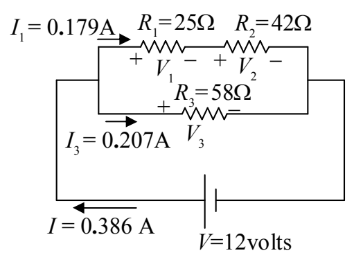

I copy that here with the values of the current included:

①

It is clear from this diagram that the current $I_1$ that we just found (the current through $R_{12}$) is the current through $R_1$, and, it is the current through $R_2$.

$$I_2 = I_1$$

$$I_2 = 0.179\text{A}$$

These are answers to the problem.

With the current through $R_1$ known, we can now solve for $V_1$:

$$V_1 = I_1 R_1$$

$$V_1 = 0.179\ \text{A}\ (25\Omega)$$

$$V_1 = 4.5\ \text{volts}$$

Thus, our answers for resistor $R_1$ are:

<table><tr><td>$V_1 = 4.5$ volts</td></tr><tr><td>$I_1 = 0.18$ amperes</td></tr></table>

And, with the current through $R_2$ known, we can solve for $V_2$:

$$V_2 = I_2 R_2$$

$$V_2 = 0.179\ \text{A}\ (42\Omega)$$

$$V_2 = 7.5\ \text{volts}$$
