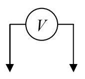
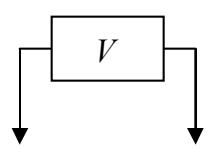
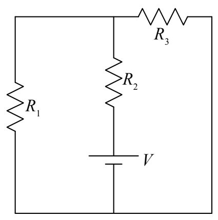

Thus, our answers for resistor $R_2$ are:

<table><tr><td>$V_2 = 7.5$ volts</td></tr><tr><td>$I_2 = 0.18$ amperes</td></tr></table>

## How to Connect a Voltmeter in a Circuit

As discussed earlier in this book, a voltmeter is a device used for measuring the potential difference between two different points in space. In a circuit, we use it to measure the potential difference between two conductors (wires) in the circuit. When you do that, the voltmeter becomes a two-terminal circuit element of the circuit. The ideal voltmeter, as a circuit element, can be considered to be a resistor with infinite resistance. As such, it has no effect on the circuit. This is good. We don’t want the measuring device to change the value of that which you are trying to measure.

A voltmeter consists of a box with two wires coming out of it. Typically, each wire ends in a metal-tipped wand (called a probe) or some kind of metal clip. The box has a gauge on it which displays the potential difference between the two wires. Touch the tip of one wire to one point in the circuit and the tip of the other wire to another point in the circuit (being sure to establish good metal-to-metal contact at both points) and the voltmeter will display the potential difference (the voltage) between those two points in the circuit.

A typical manner of depicting a voltmeter in a circuit is to draw it as

or

To connect a voltmeter to measure the voltage across $R_1$ in the following circuit:

