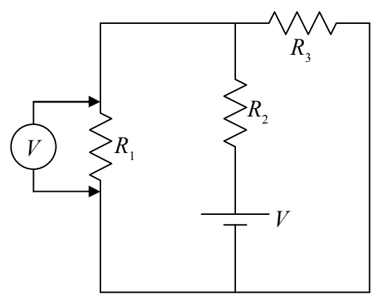
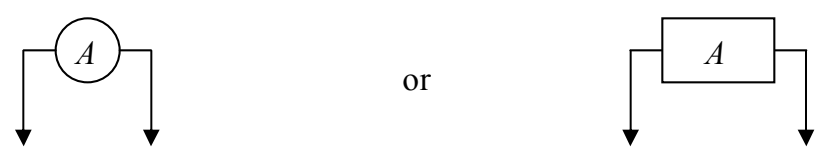
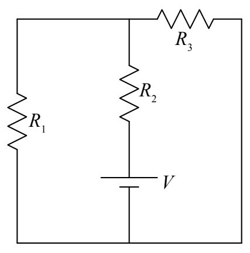

hook it up as indicated in the following diagram.

As far as its role as a circuit element (a side effect), the ideal voltmeter has as much effect on the circuit it is used on, as the air around the circuit has.

## How to Connect an Ammeter in a Circuit

The ammeter, a device used to measure current, is a totally different beast. The ideal ammeter acts like a perfectly-conducting piece of wire that monitors the charge flow through itself. Connecting it in a circuit as you would a voltmeter (don't do it!) will drastically change the circuit (and could cause damage to the meter).

A typical manner of depicting an ammeter in a circuit is to draw it as

To connect an ammeter to measure the current in  $R_{1}$  in the following circuit:

