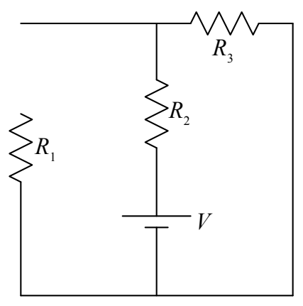
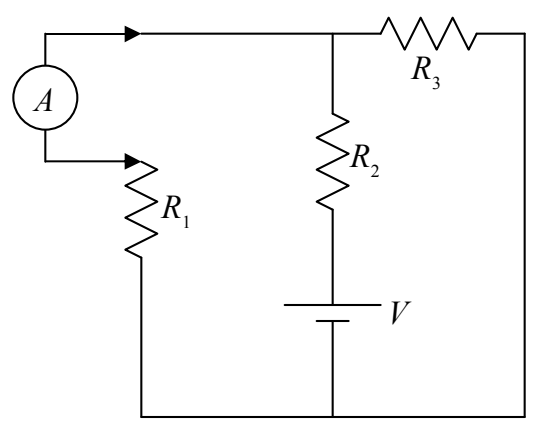

You have to first break the circuit,

and then connect the ammeter in series with the circuit element whose current you wish to measure.

Remember, to measure current with an ammeter, some disassembly is required!
