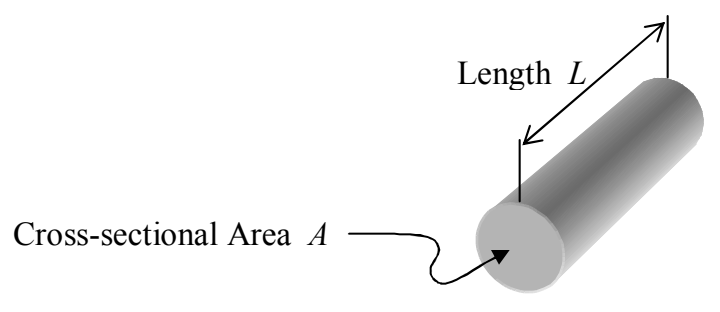

# 11 Resistivity, Power

In chapter 9 we discussed resistors that conform to Ohm’s Law. From the discussion, one could deduce that the resistance of such a resistor depends on the nature of the material of which the resistor is made and on the size and shape of the resistor. In fact, for resistors made out of a single kind of material, in the shape of a wire$^{1}$ with a terminal at each end,

the resistance is given by:

$$R = \rho \frac{L}{A} \tag{11-1}$$

where:

$R$ is the resistance of the resistor as measured between the ends,

$\rho$ is the resistivity of the substance of which the resistor is made,

$A$ is the cross-sectional area of the wire-shaped resistor, and

$L$ is the length of the resistor.

The values of resistivity for several common materials are provided in the following table:

| Material | Resistivity $\rho$ |
| :--- | :--- |
| Silver | $1.6 \times 10^{-8} \Omega \cdot m$ |
| Copper | $1.7 \times 10^{-8} \Omega \cdot m$ |
| Gold | $2.4 \times 10^{-8} \Omega \cdot m$ |
| Aluminum | $3 \times 10^{-8} \Omega \cdot m$ |
| Tungsten | $5.6 \times 10^{-8} \Omega \cdot m$ |
| Nichrome | $1.0 \times 10^{-6} \Omega \cdot m$ |
| Seawater | $0.25 \Omega \cdot m$ |
| Rubber | $1 \times 10^{13} \Omega \cdot m$ |
| Glass | $1 \times 10^{10}$ to $1 \times 10^{14} \Omega \cdot m$ |
| Quartz | $5 \times 10^{15}$ to $7.5 \times 10^{17} \Omega \cdot m$ |

$^{1}$ The resistor can have any shape such that one linear dimension can be identified as the length of the resistor, and, such that the intersection of a plane perpendicular to the length of the resistor, at any position along the length of the resistor, has one and the same area (the cross-sectional area of the resistor). I am calling the shape “the shape of a wire” for ease in identification of what we mean by the “along-the-length” dimension.
