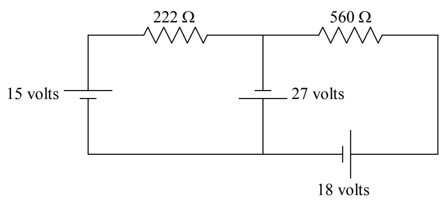
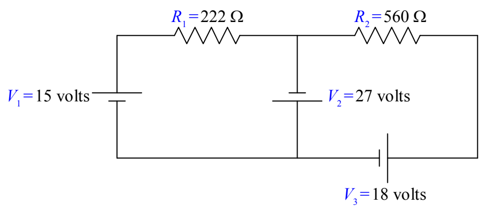

down staircases, you end up on the same floor of the mansion, your total elevation change is zero.

In dragging your finger around a closed loop of a circuit (in any direction you want, regardless of the current direction) and adding each of the voltage changes to a running total, the critical issue is the algebraic sign of each voltage change. In the following example we show the steps that you need to take to get those signs right, and to prove to the reader of your solution that they are correct.

## Example

Find the current through each of the resistors in the following circuit.

Before we get started, let’s define some names for the given quantities:

Each two-terminal circuit element has one terminal that is at a higher potential than the other terminal. The next thing we want to do is to label each higher potential terminal with a “+” and each lower-potential terminal with a “–”. We start with the seats of EMF. They are trivial. By definition, the longer parallel line segment, in the symbol used to depict a seat of EMF, is at the higher potential.
