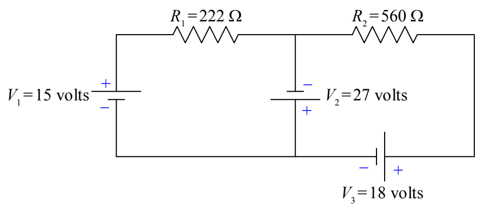
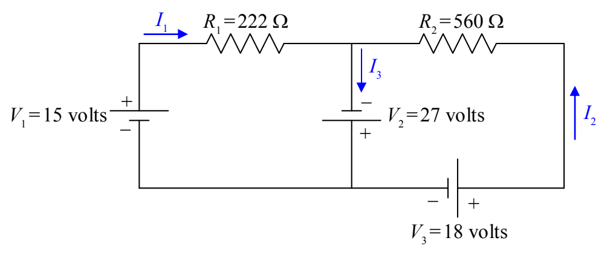

Next we define a current variable for each “leg” of the circuit. A “leg” of the circuit extends from a point in the circuit where three or more wires are joined (called a junction) to the next junction. All the circuit elements in any one leg of the circuit are in series with each other, so, they all have the same current through them.

Note: In defining your current variables, the direction in which you draw the arrow in a particular leg of the circuit, is just a guess. Don’t spend a lot of time on your guess. It doesn’t matter. If the current is actually in the direction opposite that in which your arrow points, you will simply get a negative value for the current variable. The reader of your solution is responsible for looking at your diagram to see how you have defined the current direction and for interpreting the algebraic sign of the current value accordingly.

Now, by definition, the current is the direction in which positive charge carriers are flowing. The charge carriers lose electric potential energy when they go through a resistor, so, they go from a higher-potential conductor, to a lower-potential conductor when they go through a resistor. That means that the end of the resistor at which the current enters the resistor is the higher potential terminal (+), and, the end at which the current exits the resistor is the lower-potential terminal (−) of the resistor.
