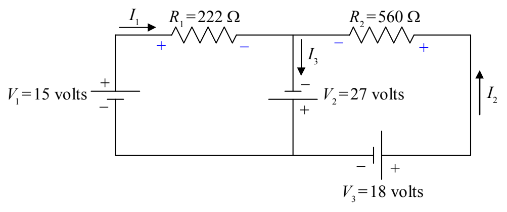
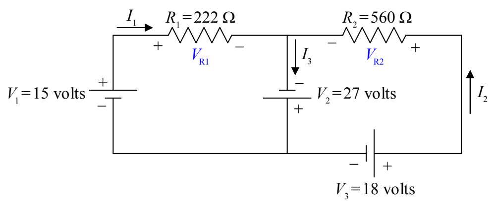

Now let’s define some variable names for the resistor voltages:

Note that the + and – signs on the resistors are important parts of our definitions of $V_{R1}$ and $V_{R2}$. If, for instance, we calculate $V_{R1}$ to have a positive value, then, that means that the left (as we view it) end of $V_{R1}$ is at a higher potential than the right end (as indicated in our diagram). If $V_{R1}$ turns out to be negative, that means that the left end of $R_1$ is actually at a lower potential than the right end. We do not have to do any more work if $V_{R1}$ turns out to be negative. It is incumbent upon the reader of our solution to look at our circuit diagram to see what the algebraic sign of our value for $V_{R1}$ means.

With all the circuit-element terminals labeled “+” for “higher potential” or “–” for “lower potential,” we are now ready to apply the Loop Rule. I’m going to draw two loops with arrowheads. The loop that one draws is not supposed to be a vague indicator of direction but a specific statement that says, “Start at this point in the circuit. Go around this loop in this direction, and, end at this point in the circuit.” Also, the starting point and the ending point should be the same. In particular, they must be on the same conductor. (Never start the loop on a circuit element.) In the following diagram are the two loops, one labeled ① and the other labeled ②.
