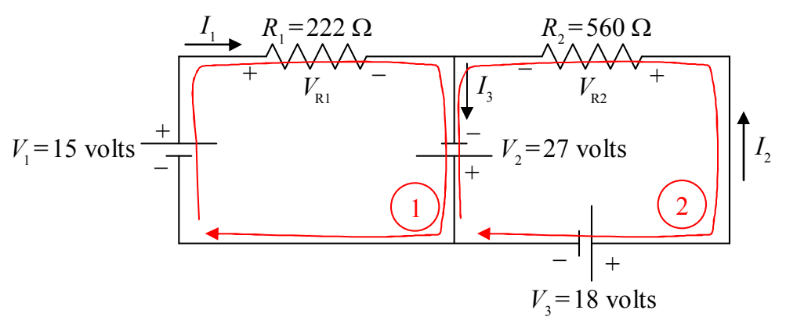

Now we write KVL ① to tell the reader that we are applying the Loop Rule (Kirchhoff's Voltage Law) using loop ①, and transcribe the loop equation from the circuit diagram:

KVL ①

$$
+ V_1 - V_{\mathrm{R1}} + V_2 = 0
$$

The equation is obtained by dragging your fingertip around the exact loop indicated and recording the voltage changes experienced by your fingertip, and then, remembering to write “= 0.” Starting at the point on the circuit closest to the tail of the loop 1 arrow, as we drag our finger around the loop, we first traverse the seat of EMF, $V_1$. In traversing $V_1$ we go from lower potential (−) to higher potential (+). That means that the finger experiences a positive change in potential, hence, $V_1$ enters the equation with a positive sign. Next we come to resistor $R_1$. In traversing $R_1$ we go from higher potential (+) to lower potential (−). That's a negative change in potential. Hence, $V_{\mathrm{R1}}$ enters our loop equation with a negative sign. As we continue our way about the loop we come to the seat of EMF $V_2$ and go from lower potential (−) to higher potential (+) as we traverse it. Thus, $V_2$ enters the loop equation with a positive sign. Finally, we arrive back at the starting point. That means that it is time to write “= 0.”

We transcribe the second loop equation in the same fashion:

KVL ②

$$
- V_2 + V_{\mathrm{R2}} - V_3 = 0
$$

With these two equations in hand, and knowing that $V_{\mathrm{R1}} = I_1 R_1$ and $V_{\mathrm{R2}} = I_2 R_2$, the solution to the example problem is straightforward. (We leave it as an exercise for the reader.) It is now time to move on to Kirchhoff's other law.
