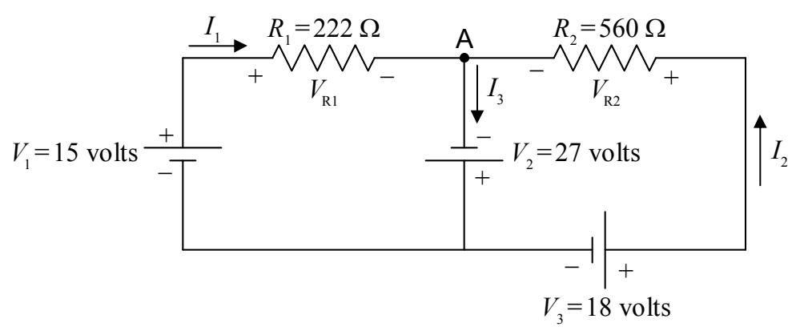

## Kirchhoff’s Current Law (a.k.a. the Junction Rule)

Kirchhoff’s junction rule is a simple statement of the fact that charge does not pile up at a junction. (Recall that a junction is a point in a circuit where three or more wires are joined together.) I’m going to state it two ways and ask you to pick the one you prefer and use that one. One way of stating it is to say that the net current into a junction is zero. Check out the circuit from the example problem:

In this copy of the diagram of that circuit, I put a dot at the junction at which I wish to apply Kirchhoff’s Current Law, and, I labeled that junction “A.”

Note that there are three legs of the circuit attached to junction A. In one of them, current $I_1$ flows toward the junction. In another, current $I_2$ flows toward the junction. In the third leg, current $I_3$ flows away from the junction. A current away from the junction counts as the negative of that value of current, toward the junction. So, applying Kirchhoff’s Current Law in the form, “The net current into any junction is zero,” to junction A yields:

KCL A

$$I_1 + I_2 - I_3 = 0$$

Note the negative sign in front of $I_3$. A current of $-I_3$ into junction A is the same thing as a current of $I_3$ out of that junction, which is exactly what we have.

The other way of stating Kirchhoff’s Current Law is, “The current into a junction is equal to the current out of that junction.” In this form, in applying Kirchhoff’s Current Law to junction A in the circuit above, one would write:

KCL A

$$I_1 + I_2 = I_3$$

Obviously, the two results are the same.
