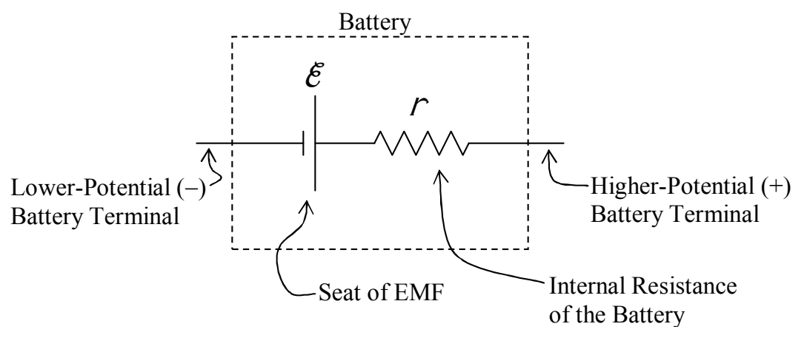

## Terminal Voltage - A More Realistic Model for a Battery or DC Electrical Power Source

Our model for a battery up to this point has been a seat of EMF. I said that a seat of EMF can be considered to be an ideal battery. This model for a battery is good as long as the battery is fairly new and unused and the current through it is small. Small compared to what? How small? Well, small enough so that the voltage across the battery when it is in the circuit is about the same as it is when it is not in any circuit. How close to being the same? That depends on how accurate you want your results to be. The voltage across a battery decreases when you connect the battery in a circuit. If it decreases by five percent and you calculate values based on the voltage across the battery when it is in no circuit, your results will probably be about 5% off.

A better model for a battery is an ideal seat of EMF in series with a resistor. A battery behaves very much as if it consisted of a seat of EMF in series with a resistor, but, you can never separate the seat of EMF from the resistor, and if you open up a battery you will never find a resistor in there. Think of a battery as a black box containing a seat of EMF and a resistor. The resistor in this model is called the internal resistance of the battery.

The point at which the seat of EMF is connected to the internal resistance of the battery is inaccessible. The potential difference between the terminals of the battery is called the terminal voltage of the battery. When the battery is not part of a circuit, the terminal voltage is equal to the EMF. You can deduce this from the fact that when the battery is not part of a circuit, there can be no current through the resistor. If there is no current through the resistor than the two terminals of the resistor must be at one and the same value of electric potential. Thus, in the diagram above, the right end of the resistor is at the same potential as the high-potential terminal of the seat of EMF.

Now, let's put the battery in a circuit:
