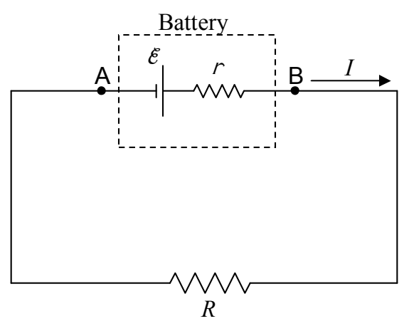
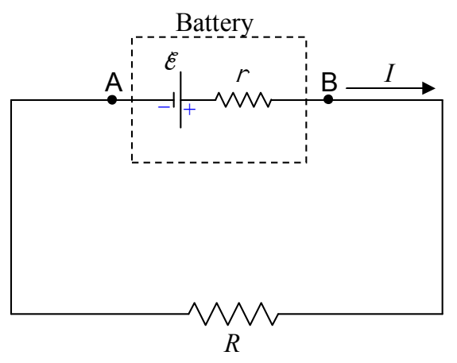

I've indicated the two points A and B on the circuit for communication purposes. The terminal voltage is the voltage from A to B ($V_{\text{AB}}$). If you trace the circuit, with your fingertip, from A to B, the terminal voltage (how much higher the potential is at B than it is at A) is just the sum of the voltage changes your finger experiences along the path. (Note that this time, we are not going all the way around a loop. We do not wind up on the same conductor upon which we started. So, the sum of the voltage changes from A to B is not zero.) To sum the voltage changes from A to B, I will mark the terminals of the components between A and B with “+” for higher potential and “−” for lower potential.

First the seat of EMF: That's trivial. The shorter side of the EMF symbol is the lower potential $(-)$ side and the longer side is the higher potential $(+)$ side.

Now, for the internal resistance of the battery: The end of the internal resistance r that the current enters is the higher-potential (+) end, and, the end that it exits is the lower-potential (−) end.
