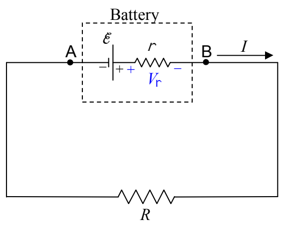
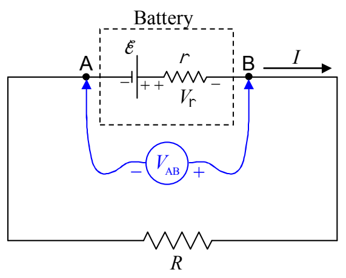

Note that I have also defined, in the preceding diagram, the variable $V_{\mathrm{r}}$ for the voltage across the internal resistance of the battery. Remember, to get the terminal voltage $V_{AB}$ of the battery, all we have to do is to sum the potential changes that our fingertip would experience if we were to drag it from A to B in the circuit. (This is definitely a thought experiment because we can't get our fingertip inside the battery.)

$$V_{AB} = \mathcal{E} - V_{\mathrm{r}}$$
$$V_{AB} = \mathcal{E} - Ir$$

Note that, in the second line, I used the definition of resistance $(V=IR)$ in the form $V_{\mathrm{r}} = Ir$, to replace $V_{\mathrm{r}}$ with $Ir$.

We have been consistent, in this book, with the convention that a double subscript such as AB can be read "A to B" meaning, in the case at hand, that $V_{AB}$ is the sum of the potential changes from A to B (rather than the other way around), in other words, that $V_{AB}$ is how much higher the electric potential at point B is than the electric potential at point A. Still, there are some books out there that take $V_{AB}$ (all by itself) to mean the voltage of A with respect to B (which is the negative of what we mean by it). So, for folks that may have used a different convention than you use, it is a good idea to diagrammatically define exactly what you mean by $V_{AB}$. Putting a voltmeter, labeled to indicate that it reads $V_{AB}$, and labeled to indicate which terminal is its "+" terminal and which is its "−" terminal is a good way to do this.

