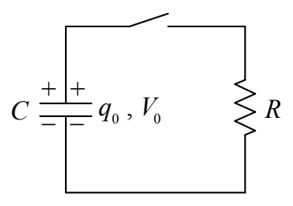
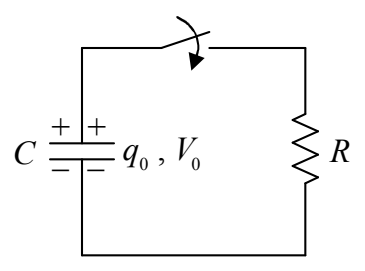
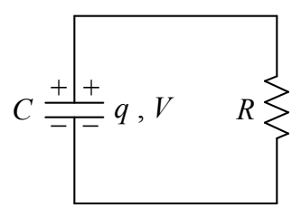

# 13 RC Circuits

Suppose you connect a capacitor across a battery, and wait until the capacitor is charged to the extent that the voltage across the capacitor is equal to the EMF $V_0$ of the battery. Further suppose that you remove the capacitor from the battery. You now have a capacitor with voltage $V_0$ and charge $q_0$, where $q_0 = C V_0$.

\[
C \frac {+ \mid +}{- \mid -} q _ {0}, V _ {0}
\]

The capacitor is said to be charged. Now suppose that you connect the capacitor in series with an open switch and a resistor as depicted below.

The capacitor remains charged as long as the switch remains open. Now suppose that, at a clock reading we shall call time zero, you close the switch.

From time 0 on, the circuit is:

The potential across the resistor is now the same as the potential across the capacitor. This results in current through the resistor:
