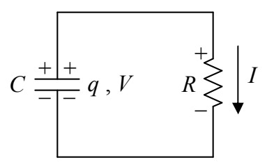
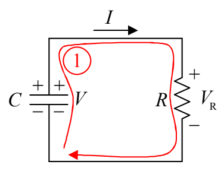

Positive charge flows from the upper plate of the capacitor, down through the resistor to the lower plate of the capacitor. The capacitor is said to be discharging. As the charge on the capacitor decreases; according to q = CV, which can be written V = q/C, the voltage across the capacitor decreases. But, as is clear from the diagram, the voltage across the capacitor is the voltage across the resistor. What we are saying is that the voltage across the resistor decreases. According to V = IR, which can be written as I = V/R, this means that the current through the resistor decreases. So, the capacitor continues to discharge at an ever-decreasing rate.

Eventually, the charge on the capacitor decreases to a negligible value, essentially zero, and the current dies down to a negligible value, essentially zero. Of interest is how the various quantities, the voltage across both circuit elements, the charge on the capacitor, and the current through the resistor depend on the time $t$. Let's apply the loop rule to the circuit while the capacitor is discharging:

KVL ①

$$+ V - V _ {\mathrm{R}} = 0$$

Using $q = CV$ expressed as $V = \frac{q}{C}$ and $V_{\mathrm{R}} = IR$, we obtain

$$\frac {q}{C} - I R = 0.$$

I is the charge flow rate through the resistor, which is equivalent to the rate at which charge is being depleted from the capacitor (since the charge flowing through the resistor comes from the capacitor). Thus I is the negative of the rate of change of the charge on the capacitor:

$$I = - \frac {d q}{d t}$$
